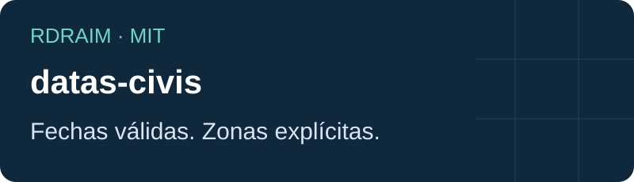
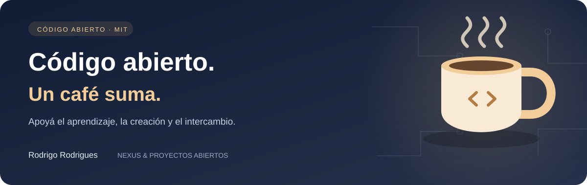

<p align="right">
  <a href="README.md"></a>
  <a href="README.en-US.md"></a>
  <a href="README.es-AR.md"></a>
</p>

# datas-civis

<!-- public-badges:start -->
[](LICENSE) [](https://github.com/Rdraim/datas-civis/actions) [](https://github.com/Rdraim/datas-civis/releases) [](https://github.com/Rdraim/datas-civis/commits/main)
<!-- public-badges:end -->

<p align="center"></p>

Fechas civiles gregorianas, diferencias de días y zonas explícitas.

Valida YYYY-MM-DD y rechaza fechas imposibles y marcas de tiempo. Suma días, compara vencimientos y presenta DD/MM/AAAA. Convertir un instante requiere una zona IANA explícita; la aritmética civil no cambia con el horario de verano.

Node.js 22 o superior. Núcleo ESM sin dependencias, utilizable en navegadores modernos. No está publicado en npm: cloná el repositorio o usá una revisión Git fija. Conservá la licencia al copiar el módulo.

## Uso

```bash
git clone https://github.com/Rdraim/datas-civis.git
cd datas-civis
npm test
npm run example
npm run example:integration
```

```js
import { adicionarDias, dataNoFuso } from './src/index.js';
adicionarDias('2024-02-28', 1); // '2024-02-29'
dataNoFuso(Date.parse('2026-01-02T01:00:00Z'), 'America/Sao_Paulo'); // '2026-01-01'
```

## Contrato

```text
validarData(data) → boolean
compararDatas(a, b) → -1 | 0 | 1
diferencaDias(inicio, fim) → number
adicionarDias(data, dias) → YYYY-MM-DD
formatarDataBR(data) → DD/MM/YYYY
dataNoFuso(epochMilliseconds, ianaTimezone) → YYYY-MM-DD
```

## Límites

Años 0001–9999, calendario gregoriano. No calcula feriados, días hábiles ni horas transcurridas. Las entradas inválidas generan errores, salvo validarData. Las zonas dependen de los datos Intl del runtime.

## Verificación

CI en Node 22 y 24, ejemplos ejecutables, pruebas de bordes y revisión heurística de contenido/historial. La revisión automática no reemplaza la inspección humana.

## Contribuciones

Abrí una Issue con el comportamiento esperado y un ejemplo sintético. Enviá un PR con prueba de regresión y documentación sincronizada en los tres idiomas. No envíes datos reales, registros, configuración ni credenciales.

## Seguridad

Usá el reporte privado de vulnerabilidades de GitHub cuando esté disponible. No publiques secretos ni datos personales en Issues. El núcleo no accede a redes, bases ni archivos; validá contratos y límites en la aplicación consumidora.

## Historial

1.0.0 — 2026-10-12: Primera versión: contrato independiente, ejemplos sintéticos, pruebas y CI.

## Licencia

[MIT](LICENSE) © Rodrigo Rodrigues

## Documentación completa

[API y recetas](API.es-AR.md) · [Compatibilidad](COMPATIBILITY.es-AR.md) · [Contribuciones](CONTRIBUTING.es-AR.md) · [Seguridad](SECURITY.es-AR.md) · [Historial](CHANGELOG.es-AR.md) · [Apoyo voluntario](SUPPORT.es-AR.md)

## Contratos TypeScript

El paquete incluye declaraciones .d.ts; el núcleo sigue siendo JavaScript ESM. Los ejemplos de tipos en test-types/consumer.mts se verificaron con un compilador existente, sin agregar dependencias. El CI ejecuta pruebas de ejecución y contenido; no instala un compilador TypeScript.

Para repetir el chequeo, usá TypeScript instalado en tu entorno:

```bash
tsc --noEmit --strict --target ES2022 --module NodeNext --moduleResolution NodeNext test-types/consumer.mts
```

## Nueva versión — 1.1.1

Agrega declaraciones TypeScript y documentación completa; conserva el contrato de ejecución.

Los indicadores son condicionales: CI aprobado, versión estable publicada y estrellas/forks mayores que cero. Se actualizan cada seis horas y por eventos; una página abierta necesita recargarse.

---

<p align="center">
  
</p>

## ☕ Invitame un café

¿Este proyecto te ayudó a resolver un problema, aprender algo nuevo o dar tus primeros pasos en desarrollo? Si querés apoyar mi trabajo, un café es una linda forma de agradecer.

Soy **Rodrigo Rodrigues**, creador de **Nexus** y de estos proyectos de código abierto. Tu aporte me ayuda a dedicar tiempo a mejorar el código, escribir ejemplos más claros y seguir compartiendo lo que aprendo.

**Aportá el monto que tenga sentido para vos. El apoyo es totalmente voluntario; el proyecto sigue siendo gratuito bajo la licencia MIT.**

[Apoyá con Pix](#apoyá-con-pix) · [Dejá un comentario](https://github.com/Rdraim/datas-civis/issues/new?title=Comentario%3A%20este%20proyecto%20me%20ayud%C3%B3)

### Apoyá con Pix

En la app de tu banco, escaneá el QR o copiá la clave Pix de abajo. Elegí el monto y revisá los datos del destinatario antes de confirmar.

<p align="center">
  
</p>

**Clave Pix**

```text
8875a24e-44d1-4c91-b6bb-62c9f0070955
```

Pix es el sistema de pagos de Brasil. Si tu banco no lo admite, también podés ayudar compartiendo el proyecto, reportando un problema, mejorando la documentación o dejando un comentario.

### Tu comentario también suma

[Contame cómo te ayudó el proyecto](https://github.com/Rdraim/datas-civis/issues/new?title=Comentario%3A%20este%20proyecto%20me%20ayud%C3%B3). Me gustaría saber qué creaste, qué aprendiste y qué podría ser más claro para quienes recién empiezan.

Los comentarios son bienvenidos con o sin donación. Cuidá tu privacidad: no publiques comprobantes de pago, datos personales, credenciales ni información privada de usuarios en las Issues.

**Gracias por apoyar mi trabajo y ayudarme a seguir creando y compartiendo. ❤️**
